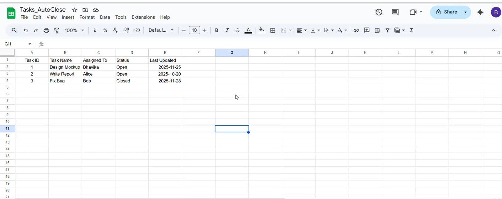
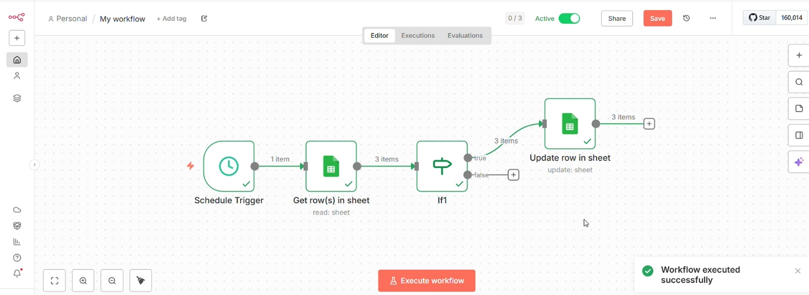
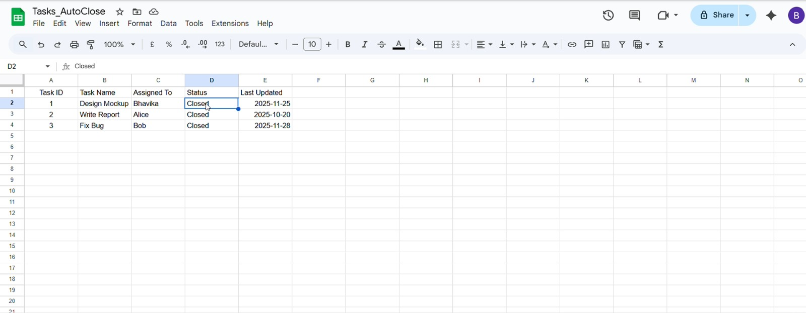

# Auto-Close Inactive Tasks

## Project Overview

Auto-Close Inactive Tasks is a personal workflow automation project built using **n8n and Google Sheets**.

It automatically retrieves task records, checks them against a configured condition, and updates eligible task statuses to **Closed**.

## Problem Statement

Manually reviewing task records and updating their statuses can be repetitive and time-consuming.

This project automates the process using n8n, reducing manual work and making task management more efficient.

## Technologies Used

- **n8n** – Workflow automation platform
- **Google Sheets** – Task data storage
- **Schedule Trigger** – Starts the workflow automatically
- **IF Node** – Evaluates task conditions
- **Google Sheets Nodes** – Retrieves and updates task records

## Workflow Architecture

```text
Schedule Trigger
       |
       v
Google Sheets - Get Rows
       |
       v
    IF Condition
       |
       v
Google Sheets - Update Row
```

## How It Works

1. **Schedule Trigger:** Starts the automation at the configured time.
2. **Get Rows:** Retrieves task records from Google Sheets.
3. **IF Condition:** Evaluates the task records against the configured condition.
4. **Update Row:** Updates eligible task records by changing their status to `Closed`.

## Demo Screenshots

### 1. Before Automation

The Google Sheet containing the original task records before automation.



### 2. n8n Workflow

The n8n workflow showing the automation process.



### 3. After Automation

The Google Sheet after successful execution, showing the updated task statuses.



## Key Features

- Scheduled workflow execution
- Automated task status updates
- Google Sheets integration
- Conditional processing using the IF node
- Reduced manual task management

## Key Learnings

- Creating automated workflows using n8n
- Integrating Google Sheets with n8n
- Working with triggers and conditional logic
- Retrieving and updating spreadsheet records
- Building practical workflow automation solutions

## Project Information

- **Project Type:** Personal Project
- **Category:** Workflow Automation
- **Tools:** n8n, Google Sheets

## Author

**Bhavika Vaishnav**
