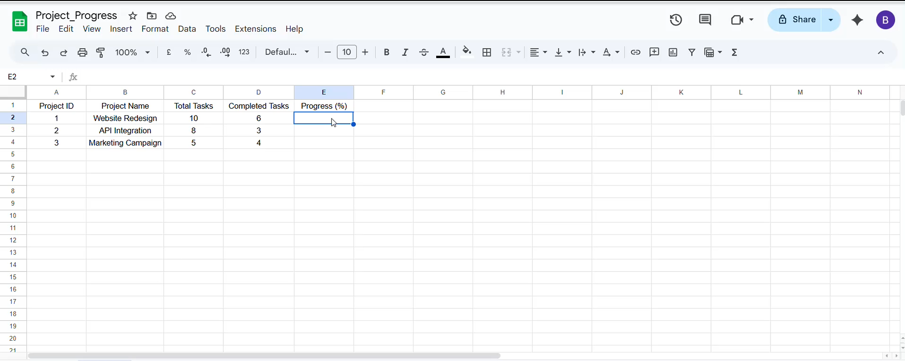
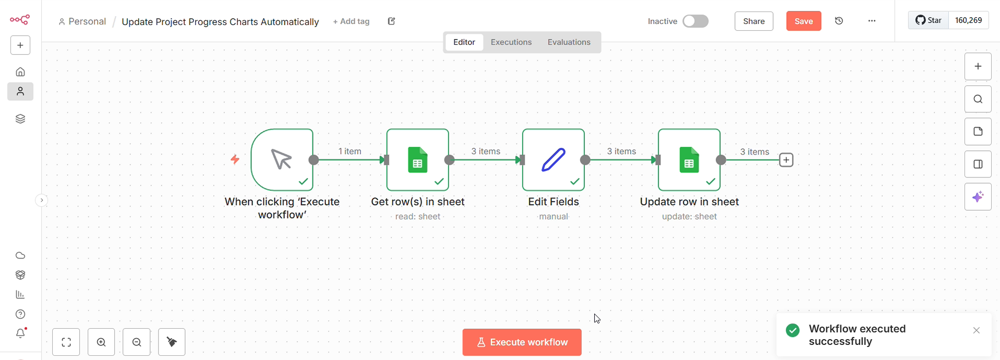
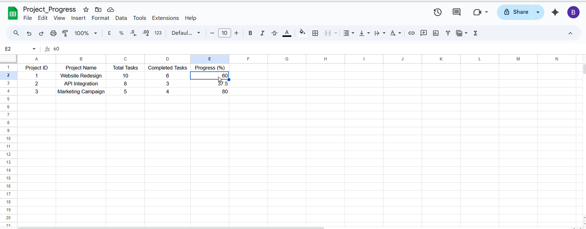

# Project 2: Update Project Progress Charts Automatically

## Project Overview
This project uses **n8n and Google Sheets** to calculate and update project completion progress automatically.

The workflow reads project records from Google Sheets, processes the task information, calculates the progress percentage, and updates the corresponding rows in the spreadsheet.

## Project Objectives
- Read project details from Google Sheets.
- Retrieve total tasks and completed tasks.
- Calculate project progress percentages.
- Update progress values directly in Google Sheets.
- Reduce manual effort in project progress tracking.

## Technologies Used
- n8n
- Google Sheets
- JavaScript (Edit Fields node)

## Workflow Architecture

The workflow consists of four nodes:

1. **Manual Trigger:** Starts the workflow when Execute Workflow is clicked.
2. **Get Rows in Sheet:** Retrieves project records from Google Sheets.
3. **Edit Fields:** Processes the project data and calculates progress percentages.
4. **Update Row in Sheet:** Updates the calculated progress values in Google Sheets.

## Repository Structure

```text
Project-2-Update-Project-Progress/
│
├── README.md
│
└── demo/
    ├── .gitkeep
    ├── 01-before-automation.png
    ├── 02-project-progress-automation-workflow.png
    └── 03-project-progress-results.png
```

## Demo Screenshots

### 1. Google Sheets Before Automation
Shows project records before the progress values are calculated.



### 2. n8n Workflow Execution
Shows the complete n8n workflow and its successful execution.



### 3. Google Sheets After Automation
Shows the updated progress percentages for all three projects.



## Sample Results

| Project Name | Total Tasks | Completed Tasks | Progress |
|---|---:|---:|---:|
| Website Redesign | 10 | 6 | 60% |
| API Integration | 8 | 3 | 37.5% |
| Marketing Campaign | 5 | 4 | 80% |

## Key Learnings
- Building multi-step workflows using n8n.
- Integrating n8n with Google Sheets.
- Retrieving and updating spreadsheet records.
- Processing project data and calculating progress.
- Automating repetitive spreadsheet operations.

## Project Type
Personal Project

## Author
Bhavika Vaishnav
