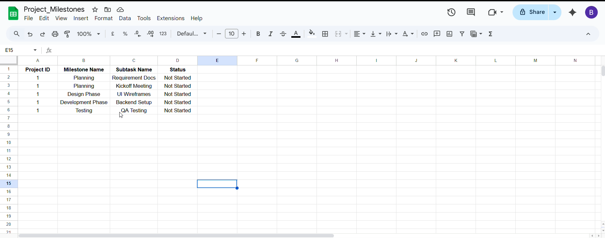
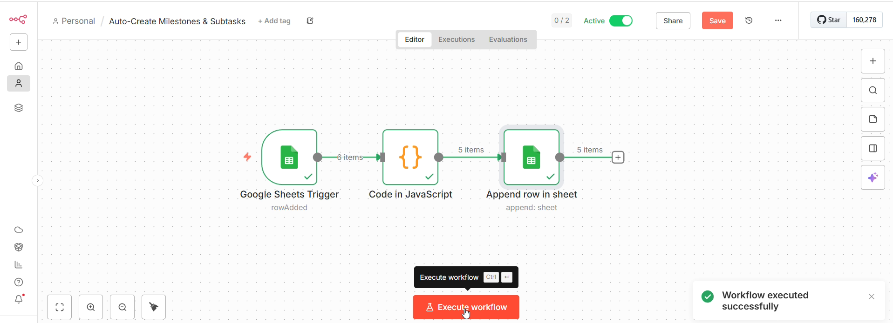
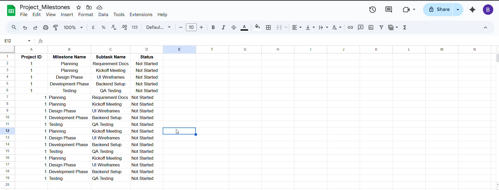

# Auto-Create Milestones & Subtasks

## Project Overview

This project is a personal workflow automation built using **n8n, Google Sheets, and JavaScript**. It automates the creation of milestone and subtask records in Google Sheets when a new row is added.

The workflow uses a Google Sheets Trigger to detect new rows, a JavaScript Code node to process the incoming data, and an Append Row node to add the generated records to the spreadsheet.

## Project Highlights

- Detects newly added rows using Google Sheets Trigger.
- Processes incoming data using JavaScript.
- Automates the creation of milestone and subtask records.
- Appends generated records to Google Sheets.
- Reduces repetitive manual data entry.

## Technology Stack

- **Automation Tool:** n8n
- **Data Storage:** Google Sheets
- **Programming Language:** JavaScript
- **Integration:** Google Sheets Trigger and Append Row nodes

## Workflow Architecture

1. **Google Sheets Trigger:** Detects when a new row is added to the spreadsheet.
2. **Code in JavaScript:** Processes the incoming data and prepares milestone and subtask records.
3. **Append Row in Sheet:** Adds the processed records to Google Sheets.

## Demo Screenshots

### 1. Before Automation

Shows the initial milestone and subtask records in Google Sheets.

### 2. n8n Workflow

Shows the complete automation workflow and its successful execution.

### 3. After Automation

Shows the spreadsheet after the workflow execution.

## Key Learnings

- Building event-driven workflows using n8n.
- Integrating Google Sheets with automation workflows.
- Using JavaScript to process workflow data.
- Automating spreadsheet operations.
- Understanding workflow execution and data flow.

## Project Type

Personal Project

## Author

**Bhavika Vaishnav**
