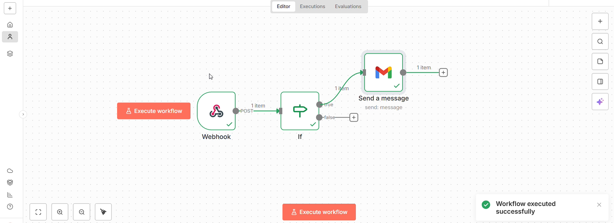
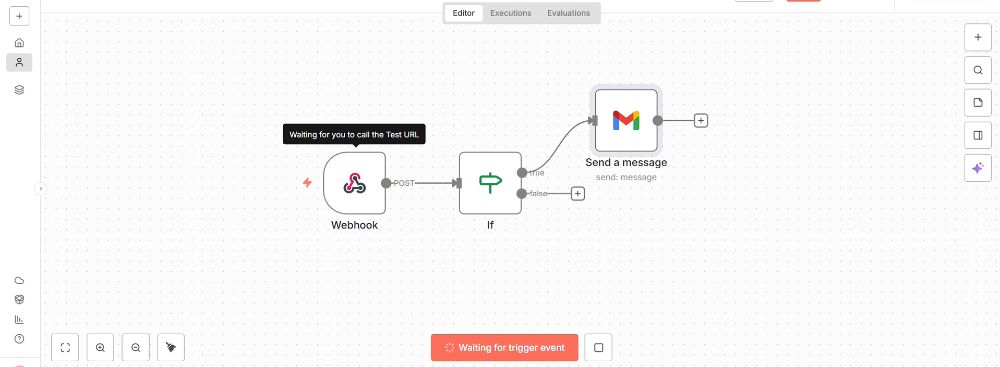
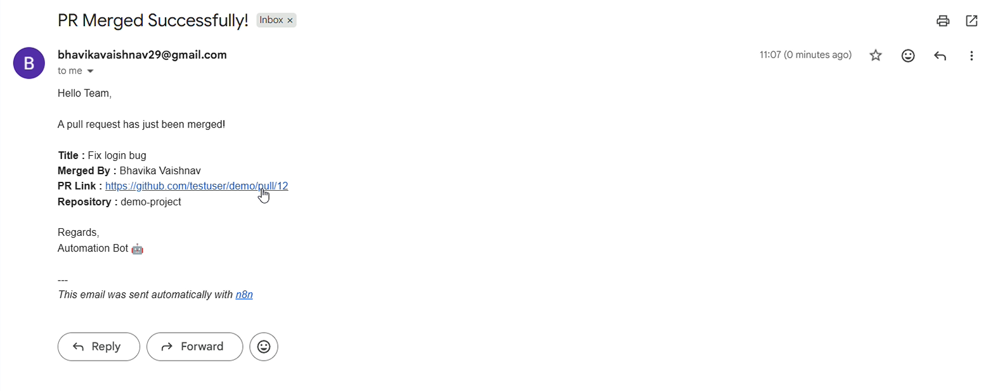

# PR Merge Notification Workflow

## Project Overview

This project is an automated workflow built using **n8n** to send email notifications when a Pull Request (PR) merge event is received.

The workflow uses a webhook to receive event data, an IF node to check the specified condition, and Gmail to send an email notification when the condition is satisfied.

## Project Highlights

- Receives Pull Request event data through a webhook.
- Uses conditional logic to evaluate the received event.
- Sends email notifications using Gmail.
- Reduces the need for manual notification checks.
- Automates communication around Pull Request events.

## Technology Stack

- **n8n** – Workflow automation
- **Webhook** – Receives event data
- **IF Node** – Conditional evaluation
- **Gmail** – Email notifications

## Workflow Structure

The automation consists of three main nodes:

1. **Webhook:** Receives the incoming Pull Request event.
2. **IF Node:** Checks whether the received event meets the configured condition.
3. **Gmail:** Sends an email notification when the condition is satisfied.

## Workflow Demonstration

### 1. Workflow Setup

The workflow is configured with a Webhook, IF node, and Gmail integration.

### 2. Before Automation

### 3. After Automation

## Key Learnings

- Working with webhooks in n8n.
- Implementing conditional logic in workflows.
- Integrating Gmail with automation workflows.
- Automating event-based notifications.
- Connecting multiple nodes to build an automated process.

## Project Type

Personal Project | Workflow Automation

## Author

**Bhavika Vaishnav**
